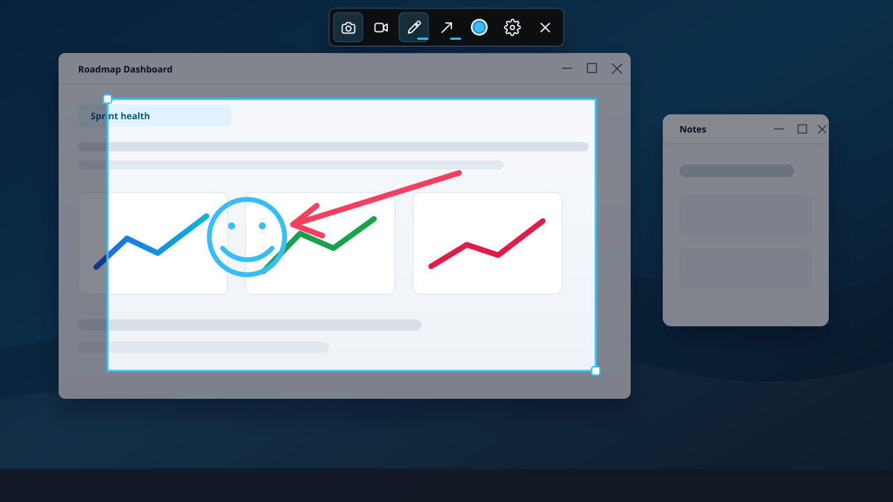
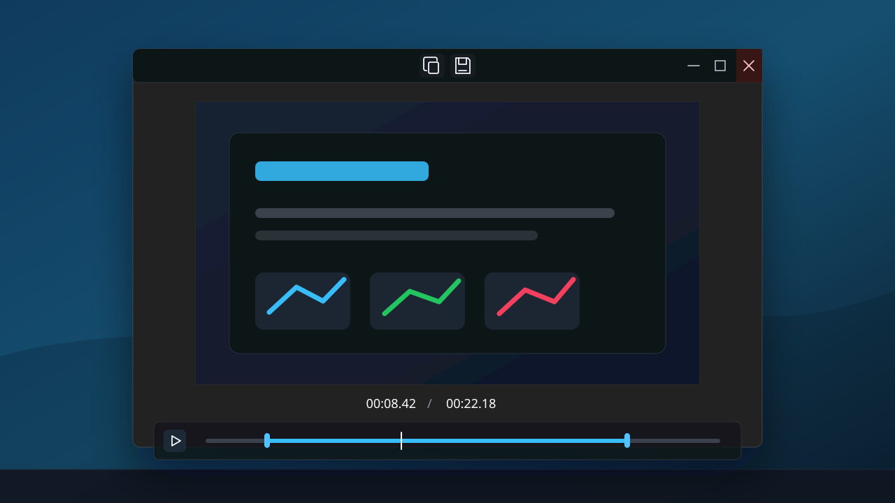

# Softshot

Softshot is a lightweight Windows screenshot and screen recording tool built for the moments when the default tools feel too slow, too crowded, or too detached from the thing you are trying to share.

Hit a shortcut, drag the exact region you want, mark it up, and save or copy it without falling into a full editing suite.

## Why Softshot

- Fast capture flow: press `PrintScreen`, select an area, and save with `Enter` or copy with `Ctrl+C`.
- Built-in markup: add quick pen strokes and arrows before you save the shot.
- Cursor-free region recording: switch the same selection into video mode, then record just that part of the screen with desktop audio and an optional microphone.
- Simple quality controls: choose `720p` or `1080p` and `30fps` or `60fps`.
- Trim before sharing: recordings open in a focused editor so you can keep only the useful part.
- Export for anywhere: one-click presets for Discord, YouTube, and X, plus GIF, M4A, and WAV exports from the editor (`Ctrl+E`).
- Edit existing clips: right-click an MP4, MOV, MKV, or WebM file and choose Open with > Softshot, or pick Open video in the tray menu.
- Clips: keep the last 15 seconds to 5 minutes of a monitor or a single app ready in memory, then press `Alt+F10` to save it. Every saved clip lands in the Gallery, where one click opens it in the editor.
- Local-first sharing: no account, cloud workspace, or project library between the capture and your clipboard.
- Tray-first desktop app: Softshot stays out of the way until you need it. Click the tray icon to open the Softshot window for Clips, the Gallery, and settings.

## Showcase

| Capture and annotate | Record and trim |
| --- | --- |
|  |  |

## How It Works

1. Start Softshot.
2. Press `PrintScreen` to open the capture overlay.
3. Drag over the region you want to capture.
4. Save the screenshot, copy it, or switch to video mode.
5. When a recording finishes, trim it in the editor and save or copy the result.

### Clips

1. Open Softshot from the tray and go to Clips.
2. Pick a monitor or an application, choose the clip length, resolution, and frame rate, then turn Clips on.
3. Press `Alt+F10` (or your own shortcut) any time to save what just happened.
4. Open Gallery to browse, copy, or edit your clips.

Clips captures and encodes on the GPU through a bundled copy of FFmpeg (Windows Graphics Capture and your NVIDIA, AMD, or Intel hardware H.264 encoder). At 1080p60 with desktop audio it uses roughly a tenth of one CPU core, and the recent seconds are kept in memory. An app that never redraws, such as an idle desktop window, is only recorded once something in it changes. When Clips is off, nothing extra runs.

If Windows or another app has already taken your capture shortcut, Softshot explains the conflict and keeps Capture available from the tray menu. You can choose another shortcut on the Capture page of the Softshot window.

## Install From Source

Softshot is currently Windows-focused and expects Node.js 24.x with npm available on your PATH. Clips also needs Softshot's own FFmpeg build, which is compiled in a Docker container, so install Docker Desktop first. Clone the repository, then run:

```powershell
cd Softshot
npm install
npm run build:ffmpeg
npm run dev
```

`npm run build:ffmpeg` only needs to run again when `scripts/ffmpeg/build.sh` changes. It writes `vendor/ffmpeg/ffmpeg.exe`, which the installer bundles.

## Build An Installer

```powershell
npm run package
```

The packaged Windows installer is written to `release/`.

## Development

```powershell
npm run build
npm run lint
```

## License

Softshot is source-available under the [PolyForm Noncommercial License 1.0.0](LICENSE.md). You may use, inspect, modify, and share it only for noncommercial purposes. Commercial use requires separate permission from Akinsoft.

Installers include a minimal build of [FFmpeg](https://ffmpeg.org) licensed under the LGPL 2.1 or later. Its license, the exact source versions, and the build configuration ship next to it in the `ffmpeg` folder, and `scripts/ffmpeg/build.sh` rebuilds it from source.

## Project Status

Softshot is early, practical, and intentionally small. The current app is focused on Windows desktop capture, region screenshots, cursor-free GPU recording, and quick trimming before sharing.
